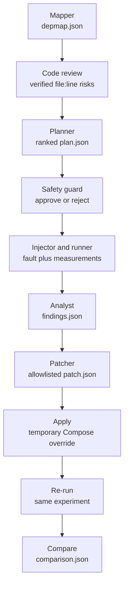

# Architecture

Chaos Agent is a source-aware, closed-loop resilience-testing system for the Robot Shop Docker Compose application. Deterministic components collect and validate evidence; Gemini proposes bounded decisions through structured JSON; the safety controller remains authoritative over every live action.

## Pipeline

The mapper parses Compose declarations, environment references, network aliases, and confirmed source calls to build the service graph. Code review extracts relevant source excerpts and asks Gemini for resilience risks; a deterministic fallback preserves operation without an API key. The planner combines those risks with dependency centrality and baseline health to select bounded experiments. The guard validates each proposal before the runner injects one fault and records measured impact. The analyst converts measurements into ranked findings, after which the patcher creates an allowlisted Compose override or source-code suggestions. The override is applied temporarily, the same experiment is re-run, and comparison reports whether the score, error rate, latency, recovery, or state survival improved. Robot Shop source files are never edited.

## How AI decisions are grounded

- **Verified citations:** A proposed code risk must name a real Robot Shop file and line and include a matching source quote. Invalid or invented citations are discarded before planning.
- **Centrality-aware ranking:** For each possible target, the planner counts all services that transitively depend on it. Code-review risk weight is multiplied by `1 + centrality`, prioritizing weaknesses with a wider potential blast radius.
- **Schema and allowlist validation:** Gemini returns structured objects only. Targets must exist in the dependency map, faults and parameters must match the allowlist, and invalid responses fall back to deterministic logic.
- **Number-checked findings:** The analyst may use only numbers present in the baseline, plan, measured result, or associated verified review. Each recommended fix must cite at least one measured error-rate, p95-latency, or recovery value, and severity cannot fall below the deterministic impact floor.
- **Validated remediation:** Compose changes are restricted to approved keys and known services. Suggestions that require application-code changes retain their verified `file:line` citation instead of being applied automatically.

## Safety controls

- Faults are limited to `kill`, `pause`, `latency`, and `cpu_stress`, and only containers labelled as part of Compose project `robot-shop` may be targeted.
- Only one experiment runs at a time, duration is capped at 60 seconds, and the runner requires a healthy steady state before injection.
- The guard aborts when error rate stays above `0.5` for 10 seconds, p95 exceeds `5000 ms`, or a service outside the calculated blast radius becomes unhealthy.
- Every injection registers its revert operation immediately. Completion, threshold aborts, Ctrl+C, and process exit trigger automatic reversion.
- Creating `STOP` in the repository root activates the kill switch. `python -m safety.recover` independently removes helper containers and network delay, stops CPU stress, unpauses or starts Robot Shop containers, resets CPU limits, and clears the active-fault record.
