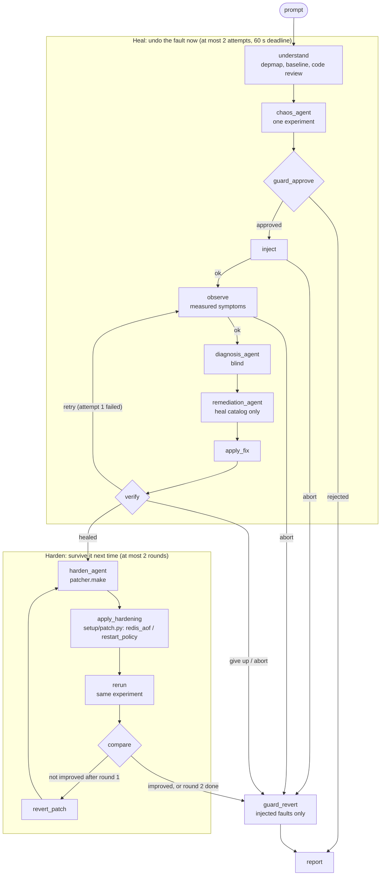

# Architecture

Chaos Agent is a source-aware, closed-loop chaos-engineering agent for the Robot Shop Docker Compose app. It reads the app's source code to find resilience weaknesses, injects one bounded fault, diagnoses the damage blind, and heals it from a fixed catalog. It then applies a live hardening fix and re-runs the same fault to measure whether the app got more resilient. Throughout, the AI proposes and the safety guard decides. The closed loop is a LangGraph (`heal/graph.py`, run with `python -m heal.run "<prompt>" --live`). `python main.py` runs the batch pipeline (map, plan, run, analyze) with the same planner, guard and analyst.

`compare` (`monitor/compare.py`) counts a re-run as improved when `data_survived` goes from false to true, `error_rate` drops by at least 0.10, or `recovery_s` drops by at least 30 %. Aborts come from the live checks: no steady state before injection, failed injection, the kill switch, collateral outside the blast radius, or the 60 s heal deadline.

## Agents

| Agent | What it does | How it is kept honest |
|---|---|---|
| Code review (`agent/code_review.py`) | Reads source excerpts and finds weaknesses such as missing timeouts, stale health flags or state kept only in redis. | Every `file:line` must exist and its quoted code must match the real file, or the item is dropped. The static scan's verified state-loss findings are added to the LLM's. |
| Chaos agent (`heal/agents.py`) / planner (`agent/planner.py`) | Picks the experiment: one per prompt in the loop, a ranked plan in `main.py`. | The prompt's named target and fault must be honoured. `guard.approve` runs inside validation, with rejections fed back to the LLM, and again live. The planner never auto-plans latency unless `CHAOS_ALLOW_LATENCY=1`. |
| Diagnosis agent | Names the suspect service and the fault. | Blind: it sees only whitelisted measured symptoms (error rate, p95, failing endpoints, health, container states, busy CPU, netem, logs) and the depmap, never the experiment. It is scored against the experiment afterwards. |
| Remediation agent | Undoes the fault now. | Catalog-only: `start_service`, `unpause_service`, `remove_latency`, `stop_cpu_stress`, plus `restart_web`, appended automatically after a backend start. `heal/fixes.py` refuses anything else, and any container not labelled `robot-shop`. |
| Analyst (`agent/analyst.py`) | Turns results into ranked findings. | Number-checked: every number the LLM writes must appear in the measured data, and each fix must quote a measured value. Severity never drops below the rule floor, and `data_survived: false` means at least `high`. The heal loop uses the rule-based analyst. |
| Patcher (`agent/patcher.py`) | Picks the hardening fix. | Allowlisted: rules decide the patch (redis data loss → `redis_aof`; slow or no recovery after a kill → `restart_policy`), with one per service per round and round 2 excluding round 1's fix. The LLM only words it. Code changes become `file:line` suggestions, and Robot Shop files are never edited. `setup/patch.py` validates again. |

## Safety controls

- **Allowlist:** faults are `kill`, `pause`, `latency` and `cpu_stress`, with exact parameters. Targets must be in the depmap and be a container labelled with Compose project `robot-shop`. Hardening fixes are only `redis_aof` (`CONFIG SET appendonly yes`, redis only) and `restart_policy` (`unless-stopped`).
- **60 s limits:** fault duration is at most 60 s, a heal must finish within 60 s of injection, and one experiment runs at a time.
- **Steady state:** injection waits for `guard.ready`, which requires every service healthy and an error rate no higher than 3× baseline.
- **Auto-abort:** the batch runner aborts when the error rate stays above 0.5 for 10 s or p95 exceeds 5000 ms. While healing, those two checks are off because they are the symptoms being healed; the deadline, kill switch and collateral checks stay on.
- **Blast radius:** the target plus every service that transitively depends on it. A service outside it going unhealthy aborts the run.
- **Kill switch, STOP file:** checked before injection, on every observation and verify sample, and before each heal action. It aborts the heal, and `guard_revert` reverts the injected fault and deletes the probe cart. It does **not** revert hardening fixes. `apply_hardening` does not check it: a re-run refuses to inject, but the next round's fix is still applied.
- **Kill switch, Ctrl+C and process exit:** after `guard.install()` (`main.py`, `heal.run --live`), `guard.revert_all()` runs every registered undo. That covers injected faults and the hardening fixes, whose undos `setup/patch.apply` registers (appendonly off, restart policy `no`). Hardening fixes therefore last only as long as the process that applied them.
- **Recovery:** `python -m safety.recover` removes helper containers and netem, stops CPU stress, unpauses or starts containers, and resets CPU limits. It does not touch hardening fixes. `python -m setup.patch revert` undoes those from `data/applied_fixes.json`.

## LLM providers

`agent/llm.py` sends every agent through one `ask_json` call. Set `LLM_PROVIDER` and `LLM_API_KEY` in `.env`:
- `ollama`: Ollama Cloud, default `gpt-oss:120b`. It uses the OpenAI-compatible API and falls back to the native `/api/chat`.
- `gemini`
- `openai`
- `anthropic`

`LLM_MODEL` overrides the model. Calls are capped at 25 s. During a live heal, the diagnosis and remediation calls get at most 15 s, and the LLM is skipped when the heal deadline leaves less than 8 s. Invalid replies are retried with the validation error fed back to the model. Every LLM agent has a deterministic fallback, used with `CHAOS_NO_LLM=1`, no key, a timeout, an exhausted quota or output that stays invalid. The report records which source answered each call.
